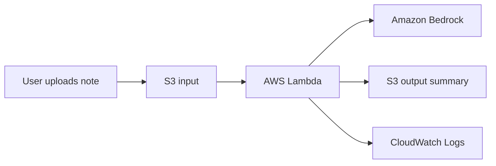

# AI Notes Summarizer

AI Notes Summarizer is a small serverless application built with AWS CDK, AWS Lambda, Amazon S3, Amazon Bedrock, and LangChain.

The application automatically summarizes text-based notes uploaded to an S3 bucket.
When a `.txt` or `.md` file is uploaded to the `INPUT_PREFIX` folder, an AWS Lambda function is triggered.
The function reads the file, sends its content to an LLM through Amazon Bedrock using LangChain,
and saves the generated summary as a Markdown file in the `OUTPUT_PREFIX` folder.


## Architecture




## How it works

1. A user uploads a `.txt` or `.md` file to the `INPUT_PREFIX` prefix in the S3 bucket.
2. S3 sends an event notification to AWS Lambda.
3. Lambda downloads the uploaded file.
4. Lambda uses LangChain and Amazon Bedrock to generate a structured summary.
5. The summary is saved back to the same S3 bucket under the `OUTPUT_PREFIX` prefix.
6. Logs are available in Amazon CloudWatch.

Example:

```txt
<INPUT_PREFIX>/product-team-meeting.txt
```

becomes:

```txt
<OUTPUT_PREFIX>/product-team-meeting-summary.md
```


## Prerequisites

Before running this project, install the following software:

- Python 3.14 or greater
- uv
- AWS CDK
- pre-commit (for development)

You also need:

- An AWS account
- AWS credentials configured locally
- Access enabled to the selected Amazon Bedrock model in your AWS region


## Configuration

Configuration is managed through environment variables.

Create your local `.env` file from `.env.example`:

```bash
cp .env.example .env
```

Then edit `.env` and adjust the values for your AWS account, region, input/output S3 prefixes, and Amazon Bedrock model.


## Installation

Install project dependencies:

```bash
uv sync
```

If this is your first time using AWS CDK in the selected AWS account and region, run:

```bash
cdk bootstrap
```


## Deployment

First, synthesize the CloudFormation template:

```bash
cdk synth
```

Then deploy the stack:

```bash
cdk deploy
```

After a successful deployment, CDK will print stack outputs, including the generated S3 bucket name.

Example output:

```txt
Outputs:
AiNotesSummarizerStack.NotesBucketName = ainotessummarizerstack-notesbucket123abc-xyz
```

Save this bucket name, because you will need it for testing.


## Testing after deployment

The repository contains sample input files in the `examples/` folder.

Upload one of the example notes to the `input/` prefix in the generated S3 bucket:

```bash
aws s3 cp examples/product-team-meeting.txt s3://<YOUR_BUCKET_NAME>/<INPUT_PREFIX>/product-team-meeting.txt
```

Wait a few seconds, then check the `OUTPUT_PREFIX` folder:

```bash
aws s3 ls s3://<YOUR_BUCKET_NAME>/<OUTPUT_PREFIX>/
```

You should see generated summary files.

Download a generated summary:

```bash
aws s3 cp s3://<YOUR_BUCKET_NAME>/<OUTPUT_PREFIX>/product-team-meeting-summary.md .
```


## Expected output format

The generated summary should follow this structure:

```md
# Summary

## Short Summary

...

## Key Points

- ...

## Decisions

- ...

## Action Items

- [ ] Task — owner, deadline if provided

## Risks and Open Questions

- ...
```

You can update this structure by changing the user prompt in [summarizer.py](lambda_src/summarizer.py) file.

## Other useful commands

Show infrastructure changes before deployment:

```bash
cdk diff
```

Destroy stack:

```bash
cdk destroy
```

List S3 objects:

```bash
aws s3 ls s3://<YOUR_BUCKET_NAME> --recursive
```


## Future improvements

Possible extensions:

- Add support for PDF files
- Add document chunking for long notes
- Store metadata in DynamoDB
- Send summaries by email using Amazon SES
- Build a RAG workflow over historical notes
